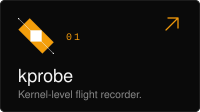
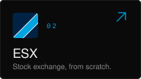
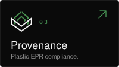
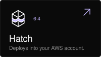

<picture>
  <source media="(prefers-color-scheme: dark)" srcset="assets/banner-fractal-dark.svg">
  
</picture>

  <picture>
    <source media="(prefers-color-scheme: dark)" srcset="assets/intro-dark.svg">
    
  </picture>

<a href="https://uttkarsh.dev"><picture><source media="(prefers-color-scheme: dark)" srcset="assets/link-portfolio-dark.svg"></picture></a>&emsp;<a href="https://www.linkedin.com/in/uttkarsh-ruparel/"><picture><source media="(prefers-color-scheme: dark)" srcset="assets/link-linkedin-dark.svg"></picture></a>&emsp;<a href="https://x.com/yhqz01"><picture><source media="(prefers-color-scheme: dark)" srcset="assets/link-x-dark.svg"></picture></a>&emsp;<a href="https://leetcode.com/u/yhqz/"><picture><source media="(prefers-color-scheme: dark)" srcset="assets/link-leetcode-dark.svg"></picture></a>

  <picture>
    <source media="(prefers-color-scheme: dark)" srcset="assets/label-selected-dark.svg">
    
  </picture>

  
  
  
  

  <picture>
    <source media="(prefers-color-scheme: dark)" srcset="assets/label-stack-dark.svg">
    
  </picture>

  <picture>
    <source media="(prefers-color-scheme: dark)" srcset="assets/stack-even-dark.svg">
    
  </picture>

