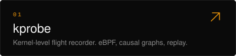
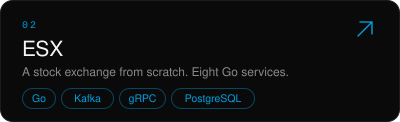
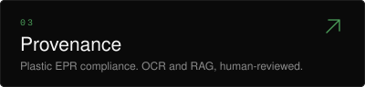
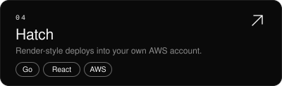

<picture>
  <source media="(prefers-color-scheme: dark)" srcset="assets/banner-dark.svg">
  
</picture>

<i>I'm a CS undergrad at SIT Pune, but my stack doesn't know that. I build backend systems the way they're supposed to be built. Then I benchmark them.</i>

<a href="https://uttkarsh.dev"><picture><source media="(prefers-color-scheme: dark)" srcset="assets/link-portfolio-dark.svg"></picture></a>&emsp;<a href="https://www.linkedin.com/in/uttkarsh-ruparel/"><picture><source media="(prefers-color-scheme: dark)" srcset="assets/link-linkedin-dark.svg"></picture></a>&emsp;<a href="https://x.com/yhqz01"><picture><source media="(prefers-color-scheme: dark)" srcset="assets/link-x-dark.svg"></picture></a>&emsp;<a href="https://leetcode.com/u/yhqz/"><picture><source media="(prefers-color-scheme: dark)" srcset="assets/link-leetcode-dark.svg"></picture></a>

 

<h3>Selected work</h3>

  
  
  
  

<h3>Stack</h3>

  <picture>
    <source media="(prefers-color-scheme: dark)" srcset="https://skillicons.dev/icons?i=go%2Crust%2Cts%2Cpy%2Cjava%2Cnodejs%2Creact%2Ckafka%2Cpostgres%2Credis%2Cdocker%2Ckubernetes%2Caws%2Cgrafana%2Cterraform&theme=dark&perline=15">
    
  </picture>

