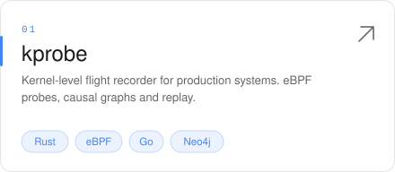
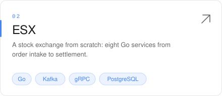
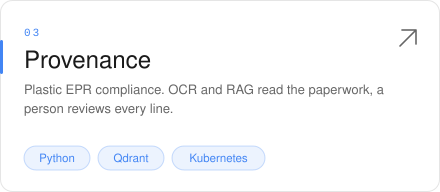
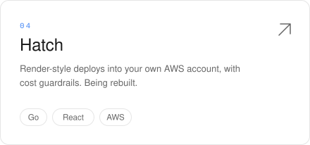

<picture>
  <source media="(prefers-color-scheme: dark)" srcset="assets/banner-dark.svg">
  
</picture>

<i>I'm a CS undergrad at SIT Pune, but my stack doesn't know that. I build backend systems the way they're supposed to be built. Then I benchmark them.</i>

   

 

<h3>Selected work</h3>

  <a href="https://github.com/YHQZ1/Kprobe"><picture><source media="(prefers-color-scheme: dark)" srcset="assets/card-kprobe-dark.svg"></picture></a>
  <a href="https://github.com/YHQZ1/ESX"><picture><source media="(prefers-color-scheme: dark)" srcset="assets/card-esx-dark.svg"></picture></a>
  <a href="https://github.com/YHQZ1/Provenance-FYP"><picture><source media="(prefers-color-scheme: dark)" srcset="assets/card-provenance-dark.svg"></picture></a>
  <a href="https://github.com/YHQZ1/Hatch"><picture><source media="(prefers-color-scheme: dark)" srcset="assets/card-hatch-dark.svg"></picture></a>

<h3>Stack</h3>

  <picture>
    <source media="(prefers-color-scheme: dark)" srcset="https://skillicons.dev/icons?i=go%2Crust%2Cts%2Cpy%2Cjava%2Cnodejs%2Creact%2Ckafka%2Cpostgres%2Credis%2Cdocker%2Ckubernetes%2Caws%2Cgrafana%2Cterraform&theme=dark&perline=15">
    
  </picture>

APIs don't judge you. Mine just return 200s.

